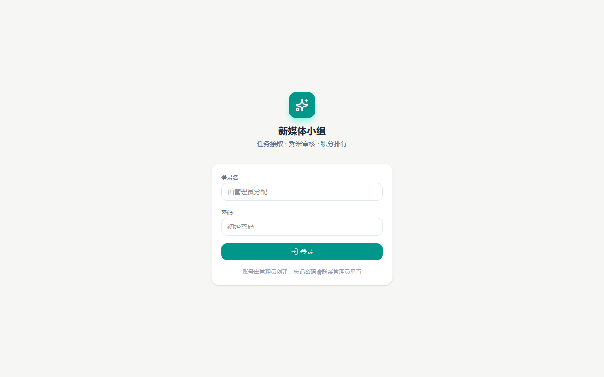
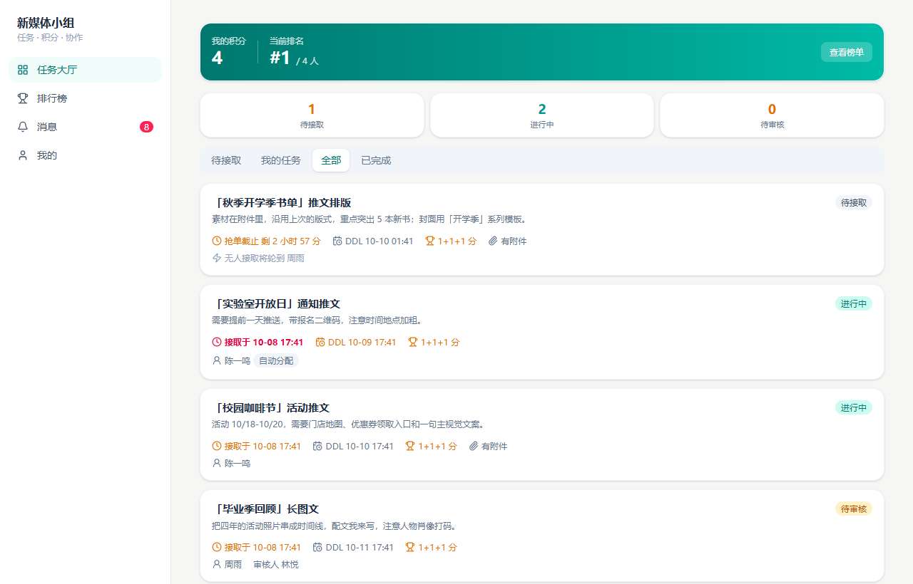
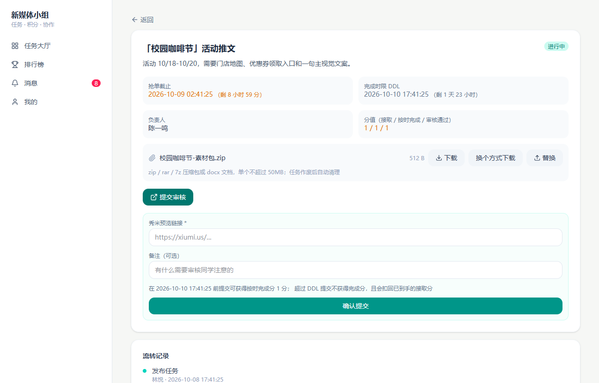
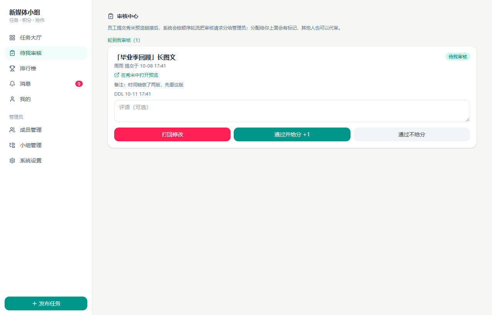
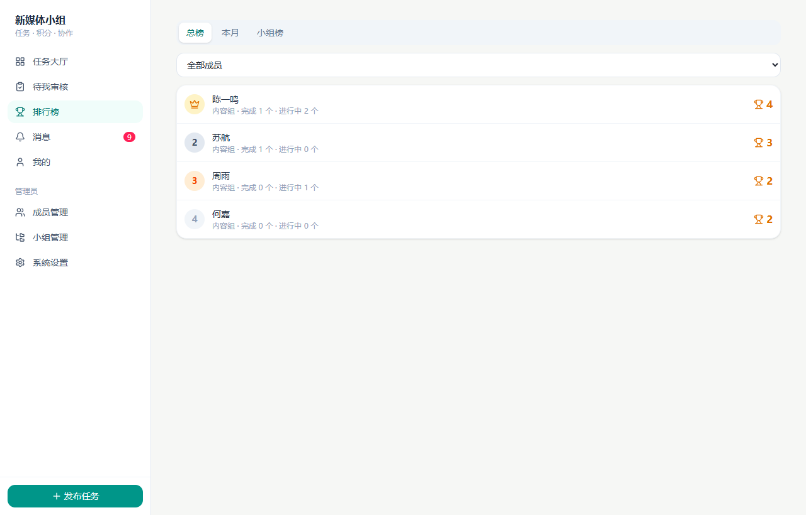
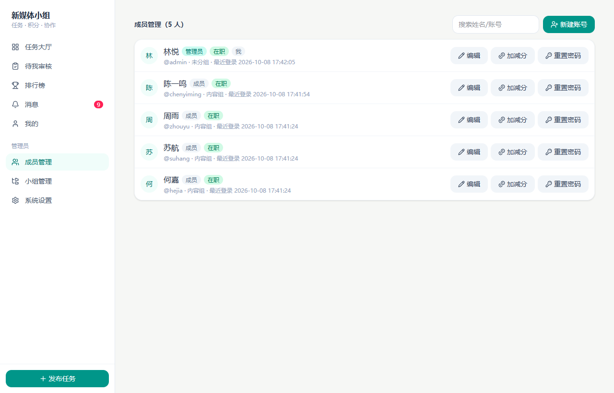
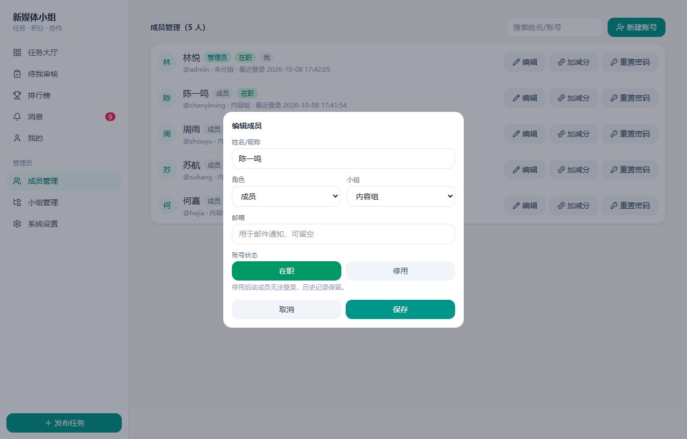
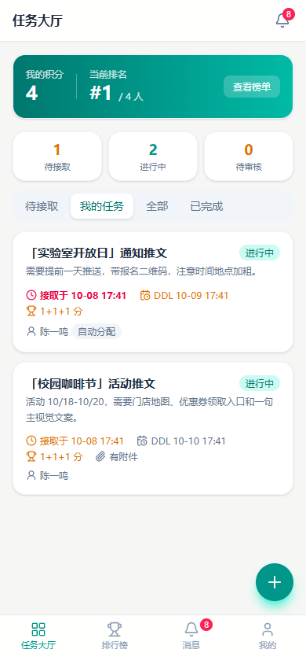
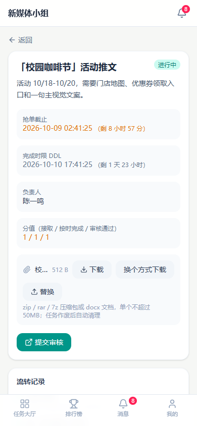

# 新媒体小组 · 任务与积分管理系统

> 面向 20 人以内新媒体小组的公众号（秀米）排版任务流转系统：**发布 → 抢单 / 超时自动轮派 → 提交预览链接 → 管理员轮流审核 → 积分排行榜**。
>
> A lightweight task & credit system for small content teams — Spring Boot 4 + Vue 3 + SQLite, ships as a single jar and runs happily in a 256MB heap.


---

## 为什么做这个

小组里排版的活儿一直是"群里喊一声，谁有空谁接"，于是：

- **谁接了、谁没接**，全靠翻聊天记录，最后总是那两个人默默干完；
- **交没交、按时没按时、谁该加分**，靠 Excel 手工记，月底对不上账；
- **审核压在一两个人身上**，没人知道这条到底该谁看，一压就是两三天。

这套系统把「抢单 → 交付 → 审核 → 计分」整条链路固化下来：**规则由代码保证，不靠自觉**。超时没人接就按顺序自动派、逾期交付就扣分、审核轮流来、分只给一次——谁都没法"忘了"。

## 功能特性

| 模块 | 能力 |
| --- | --- |
| 账号 | 只能管理员创建（无自助注册），带初始密码；新账号**首次登录强制改密**，不改不能用任何功能 |
| 任务 | 发布时可设接取时限（默认 12h）与 DDL（默认 36h）；支持挂附件、作废、按人指派 |
| 抢单 | 时限内成员自取，得「接取分」；过时不候 |
| 自动轮派 | 到点仍无人接取 → 定时任务按成员顺序轮流分配并通知本人（`assign_type=AUTO` 有标记） |
| 交付 | 提交秀米预览链接 + 备注；**待审核期间可修改后重新提交**，换新的预览链接 |
| 逾期 | 超过 DDL 才交付：不加完成分，并**扣回已经拿到的接取分**（只扣一次） |
| 审核 | 提交后按管理员顺序**轮流**指派审核人（其他人也能代审）；**评语可选**；通过时可选择**给分 / 不给分**（质量好才给分） |
| 积分 | 接取 / 按时完成 / 审核通过三项独立配分；管理员可手动加减分；完成分只记一次，打回重提不重复加 |
| 排行 | 总榜 / 本月榜 / 分组榜，同分按完成任务数排序 |
| 小组 | 可建组，**组长可以是管理员也可以是普通成员**，组长同样能发布任务；组用于分组排名 |
| 附件 | 任务附件支持 `zip / rar / 7z` 压缩包或单个 `docx`（≤50MB），可随时替换，**任务作废时自动清理磁盘** |
| 通知 | 站内消息 + 邮件（配了 SMTP 才发信） |
| 适配 | PC 侧边栏 + 手机底部 Tab，一套代码两端可用 |

## 界面预览

**登录页** —— 账号由管理员创建，页面直接写明"忘记密码请联系管理员"



**任务大厅** —— 顶部是本人积分/排名，卡片上用颜色区分紧急程度，一眼看出谁能接、谁在做、谁在等审核



**任务详情** —— 附件直接下载，提交秀米预览链接；文案里写清"逾期会扣回接取分"



**审核中心** —— 轮到我审核的有高亮标记；评语可选，通过可以选"给分"或"不给分"



**排行榜** —— 总榜 / 本月榜 / 分组榜，前三名带标记



**成员管理** —— 标签化列表，改动都收进弹窗（早期版本能在列表里直接改下拉，手滑就把自己停用了）



**编辑成员** —— 停用按钮对自己不可用，系统始终保留至少一位在职管理员



**移动端**（390 × 844）

| 任务大厅 | 任务详情 |
| --- | --- |
|  |  |

## 业务规则

**时间线**

```
发布任务 ──┬─ 接取时限内（默认 12h）── 成员抢单 ──────────┐
           │                                            │
           └─ 到点无人接取 ── 系统按顺序自动轮派并通知 ──┘
                                                        │
                                                        ▼
                                            进行中（负责人已确定）
                                                        │
                       ┌────────────────────────────────┤
                       │                                │
             DDL 前提交（默认 36h）              超过 DDL 才提交
             + 按时完成分                       不加完成分，且扣回接取分
                       │                                │
                       └───────────────┬────────────────┘
                                       ▼
                                  待审核（可改完重新提交）
                                       │
                        ┌──────────────┴──────────────┐
                    审核通过                      打回修改
                （可选给分 / 不给分）                  │
                        │                      回到「进行中」
                        ▼
                     已完成                     （完成分只记一次）
```

**几条刻意设计的规则**

1. **接取时限内才允许抢单**，过时直接被系统接管，避免"快超时了才有人抢，把自动轮派搅乱"。
2. **逾期交付要付出代价**：不加完成分之外，还会把之前拿到的接取分收回去——挂着的任务拖着不交，最后是负收益。扣回只做一次，反复重交不会反复扣。
3. **完成分只认第一次按时交付**，打回重提不会重复加分；审核分由审核人现场决定给不给。
4. **审核人轮流轮询**，分配结果会写进任务日志，代审也允许（谁有空谁处理，但每次提交只通知一个人）。
5. **待审核期间本人可以改**：秀米链接改了或者发现了错别字，不用求管理员打回，直接改完重新提交，系统会重新通知原审核人。
6. **防呆**：不能停用自己的账号、不能取消自己的管理员身份、系统必须保留至少一位在职管理员；万一数据被搞坏到没有在职管理员，**服务启动时会自动把最早的管理员恢复为在职**。

## 技术栈

| 层 | 选型 | 说明 |
| --- | --- | --- |
| 后端 | Spring Boot 4.1.1 + JDK 21 | 打成单个 fat jar，`-Xmx256m` 实测常驻约 210MB |
| 鉴权 | Sa-Token 1.46.0 | 请求头 `satoken` 传 token，7 天有效期，支持强制改密拦截 |
| 持久层 | MyBatis-Plus 3.5.17 + SQLite | 单文件库，零安装零运维 |
| 前端 | Vue 3 + Vite 6 + Tailwind CSS 4 | 移动端优先，图标全部用 lucide（不用 emoji） |
| 通知 | 站内消息 + Spring Mail | 不配 SMTP 就只走站内消息 |
| 部署 | systemd + nginx | 一个 jar 一个 sqlite 文件，反代挂子域名 |

## 快速开始

```bash
# 1. 构建前端（产物会输出到 src/main/resources/static）
cd frontend && npm install && npm run build

# 2. 打包后端
cd .. && ./mvnw -DskipTests package        # Windows: .\mvnw.cmd

# 3. 运行（默认 8080）
java -Xmx256m -jar target/xinmeiti.jar
```

打开 http://localhost:8080 ，默认管理员 **admin / admin123**（首次登录会强制你改密码）。

前后端分离开发（前端热更新，已配好 `/api` 代理）：

```bash
java -Xmx256m -jar target/xinmeiti.jar   # 后端 8080
cd frontend && npm run dev               # 前端 5173
```

## 配置项

全部可以用环境变量覆盖（`application.yml` 里有对照）。

| 变量 | 默认值 | 说明 |
| --- | --- | --- |
| `SERVER_PORT` | 8080 | 监听端口 |
| `XMT_DB_PATH` | `./data/xinmeiti.db` | SQLite 文件路径 |
| `XMT_UPLOAD_DIR` | `./data/uploads` | 任务附件目录 |
| `XMT_ADMIN_USERNAME` / `XMT_ADMIN_PASSWORD` | admin / admin123 | 首次启动自动创建的管理员 |
| `XMT_SITE_URL` | http://localhost:8080 | 邮件里的跳转地址 |
| `XMT_MAIL_ENABLED` | true | 邮件总开关 |
| `MAIL_HOST` / `MAIL_PORT` / `MAIL_USERNAME` / `MAIL_PASSWORD` | 空 | 配了才发邮件 |
| `XMT_AUTO_ASSIGN_FIXED_DELAY` | 30000 | 自动轮派扫描间隔（毫秒） |

## 部署

最小可用的一套（Ubuntu + systemd + nginx），把 jar 丢上去、反代挂个子域名就完事：

```bash
# 运行环境
sudo apt-get install -y openjdk-21-jre-headless
sudo mkdir -p /opt/xinmeiti/data && sudo chown -R deploy:deploy /opt/xinmeiti
scp target/xinmeiti.jar xiaoyu:/opt/xinmeiti/
```

`/etc/systemd/system/xinmeiti.service`：

```ini
[Unit]
Description=xinmeiti - 新媒体小组管理系统
After=network.target

[Service]
Type=simple
User=deploy
WorkingDirectory=/opt/xinmeiti
Environment=TZ=Asia/Shanghai
Environment=SERVER_PORT=18081
Environment=XMT_DB_PATH=/opt/xinmeiti/data/xinmeiti.db
Environment=XMT_UPLOAD_DIR=/opt/xinmeiti/data/uploads
ExecStart=/usr/bin/java -Xmx256m -Xss512k -XX:MaxMetaspaceSize=160m -XX:+UseSerialGC -Dfile.encoding=UTF-8 -jar /opt/xinmeiti/xinmeiti.jar
Restart=always
RestartSec=10
SuccessExitStatus=143

[Install]
WantedBy=multi-user.target
```

nginx 反代（`/etc/nginx/sites-available/xinmeiti`）：

```nginx
server {
    listen 80;
    server_name xinmeiti.example.com;

    client_max_body_size 60M;          # 附件上限 50MB，留点余量

    location / {
        client_body_buffer_size 10M;
        proxy_request_buffering off;
        proxy_pass http://127.0.0.1:18081;
        proxy_set_header Host $host;
        proxy_set_header X-Real-IP $remote_addr;
        proxy_set_header X-Forwarded-For $proxy_add_x_forwarded_for;
        proxy_set_header X-Forwarded-Proto $scheme;
        proxy_read_timeout 300s;
        proxy_send_timeout 300s;
    }
}
```

```bash
sudo systemctl daemon-reload && sudo systemctl enable --now xinmeiti
sudo nginx -t && sudo systemctl reload nginx
sudo certbot --nginx -d xinmeiti.example.com     # 签发 HTTPS
```

**升级**：本地 `./mvnw -DskipTests package` → `scp` 覆盖 jar → `sudo systemctl restart xinmeiti`。
数据库结构变更由启动时的自动补列处理（见下方设计说明），不需要手工改表。

> nginx/证书/备份/排障等更细的内容见 [`docs/DEPLOY.md`](docs/DEPLOY.md)。

## 目录结构

```
xinmeiti/
├── frontend/                         # Vue 3 前端
│   └── src/
│       ├── views/                    # 页面：任务大厅 / 任务详情 / 审核中心 / 排行榜 / 成员 / 小组 / 设置 / 我的
│       ├── components/               # AppLayout（PC 侧栏 + 手机底栏）、TaskCard
│       ├── api.js                    # 统一请求封装（token、1001 强制改密、1003 掉线处理）
│       └── store.js                  # 轻量全局状态 + 文案映射
└── src/main/java/cn/tazumesans/xinmeiti/
    ├── common/      统一响应、业务异常、口令哈希（PBKDF2）、时间工具
    ├── config/      MyBatis-Plus、Web（拦截器 / CORS / 静态资源缓存）
    ├── security/    AuthKit（当前登录人）+ 登录拦截器（含强制改密拦截）
    ├── model/       MyBatis-Plus 实体
    ├── mapper/      Mapper（含排行榜连表 SQL）
    ├── user/        账号、登录、成员管理
    ├── group/       小组
    ├── task/        任务（发布 / 抢单 / 自动轮派 / 提交 / 审核 / 附件）+ 定时任务
    ├── score/       积分流水与排行榜
    ├── notify/      站内消息 + 邮件
    └── system/      启动引导、系统配置、SPA 路由回退
```

## 设计说明

**1. 为什么是 SQLite 而不是 MySQL**
小组规模 20 人、QPS 个位数，一个 `.db` 文件足够，备份就是拷文件，服务器上少一个常驻进程就少一份内存和维护成本。为此把 HikariCP 连接池压到 **1 个连接** 并开了 WAL，SQLite 的写锁竞争在这个量级完全不是问题。

**2. 内存预算按 600MB 以内设计**
目标机器是 1.6G 内存的小机器，JVM 参数给 `-Xmx256m -XX:MaxMetaspaceSize=160m -XX:+UseSerialGC`，实测常驻约 **210MB**；Tomcat 线程数、multipart 阈值（超过 1KB 直接落盘）也都按"省内存"配的。

**3. `TZ=Asia/Shanghai` 是必须的**
接取时限、DDL 全部是 `yyyy-MM-dd HH:mm:ss` 的**本地时间字符串**，直接参与 SQL 比较（`claim_deadline <= now`）。时区不对，超时轮派和逾期判断会整体偏移，所以 systemd 单元里显式设了时区。

**4. 老库自动补列**
建表脚本用的是 `CREATE TABLE IF NOT EXISTS`，新增字段不会自动出现在已有库里——上线途中就踩过这个坑：模型里加了附件字段，老库缺列，导致所有任务查询直接 500。现在启动时会对比 `PRAGMA table_info` 按需 `ALTER TABLE ADD COLUMN`，加字段不用再手工改线上库。

**5. 附件生命周期**
附件按 `tasks/{taskId}/` 存放，重新上传时删掉旧文件；**任务作废时连文件带字段一起清理**，已完成的任务则保留，方便回头找素材。下载走带上 token 的直链，交给浏览器原生下载（比 `fetch` + Blob 兼容性更好，还能在下载管理器里看到进度）。

**6. 前端不用 emoji 做图标**
全部用 lucide 矢量图标，一是风格统一、二是不同设备 emoji 渲染差异太大；配色统一走墨绿（`#0f766e`），不用蓝紫。

**7. 权限只有两层，但留了组长的口子**
`ADMIN` / `EMPLOYEE` 两种角色，判定集中在 `AuthKit`（`requireAdmin` / `requireCanPublish`）。组长（哪怕只是普通成员）也拥有发布权限——发布权和审核权是分开的两回事。

## License

[MIT](LICENSE)
